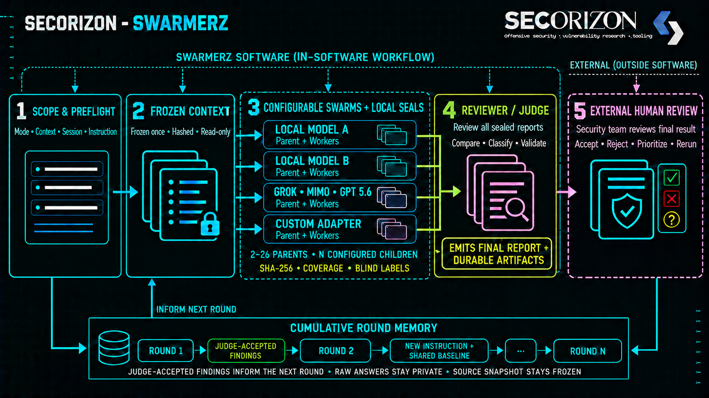
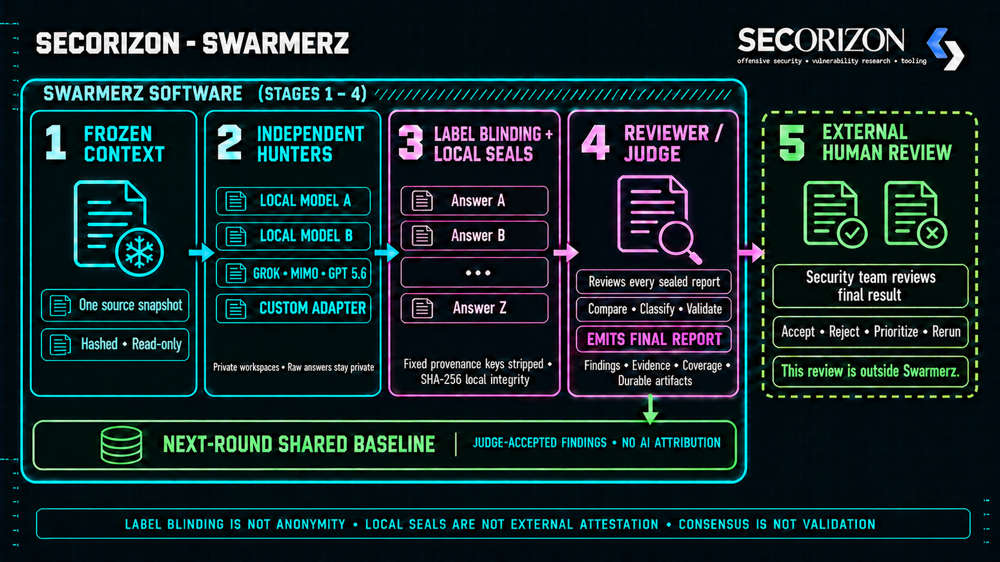

<!--
Author: Laurent Gaffié, Secorizon.com
SPDX-License-Identifier: GPL-3.0-only
This file is part of Swarmerz, a terminal operations deck for independent model swarms.
-->

# SECORIZON - SWARMERZ

**Author:** Laurent Gaffié, [Secorizon.com](https://secorizon.com)

Swarmerz is Secorizon's terminal operations deck for independent model swarms. It combines frozen
evidence, supervised private worker fan-out, locally sealed answers, and blind adjudication—with an
optional independent pre-hunt baseline—in an interface designed for long, high-consequence
investigations. The orchestration is model- and provider-agnostic: a fleet can use local Ollama
models, LAN-hosted inference, commercial APIs, custom command adapters, or a deliberate mix. The
shipped configuration uses several hosted routes and Codex adjudication as one operational example,
not as a product requirement or capacity ceiling.

```text
  SECORIZON - SWARMERZ  //  CONSENSUS IS THE EXPLOIT.
  MISSION  Protocol-Audit / RUN       ELAPSED  00:41:18   PHASE  HUNTING

 ┌─ FLEET ────────────────┐┌─ WORKSPACE ─────────────────────┐┌─ MISSION ────────────┐
 │▌ LOCAL-A     HUNTING   ││01:14:21  local-a   workers 4/4  ││ PHASE VECTOR         │
 │  ━━━━━━━ 4/4     54.9k ││01:14:23  local-b   tool shell   ││ ◆ FREEZE ◆ BASE      │
 ││ LOCAL-B     BLOCKED   ││01:14:31  local-b   permission   ││ ◆ HUNT   ● QUORUM    │
 │  ━━━━━── 3/4     35.9k ││01:14:36  control   delivered    ││ ○ JUDGE  ○ VERIFY    │
 ││ HOSTED-C    HUNTING   ││                                 ││ ○ SEAL · sealed 1/5  │
 │  ━━━──── 2/4     18.8k ││                                 ││ focus local-a        │
 └────────────────────────┘└─────────────────────────────────┘└──────────────────────┘
  COMMAND  › /to local-b finish the provider sweep and preserve evidence
  F1 map  F2 signal  F3 reports  F4 synthesis  F5 mission  F9 theme  Tab focus  Ctrl-Q exit
```

> [!IMPORTANT]
> Use Swarmerz only against systems and data you are authorized to test. The shipped example launches
> seven parents with four children each, but those are configuration choices: Swarmerz accepts 2–26
> top-level hunters and does not impose an application-level maximum on children per parent. All
> configured parents start independently. Baseline-first review is disabled by default; enabling it
> adds an adjudicator call before hunting as well as the final review. Check local compute/VRAM,
> provider cost and rate limits, data-handling requirements, and scope before submitting the final
> command.

## Documentation

- [Installation and platform support](docs/installation.md)
- [Configuration reference](docs/configuration.md)
- [CLI reference](docs/cli-reference.md)
- [Operating missions and recovery](docs/operations.md)
- [Security and trust model](docs/security-model.md)

## Quick start

Requirements:

- Linux or macOS with an interactive terminal and Python 3.12 or newer. On Windows, use WSL2;
  native Windows is not currently supported.
- The harnesses required by your configuration. OpenCode can route to local Ollama, LAN, or hosted
  providers; Claude Code and Codex are supported directly; a `command` adapter can integrate
  another local or remote runtime.
- Claude Code or Codex authentication only when the configuration selects that native harness for
  a hunter, adjudicator, or interactive follow-up. A fully local fleet needs neither, although a
  fully local adjudicator currently needs a command adapter.
- Node.js/npm only when a pinned harness must be resolved through `npx` rather than an installed
  executable. Installed Codex, Claude Code, and OpenCode CLIs are version-probed at startup; their
  resolved runtime versions are recorded even when a profile still names an older version.
- Runtime Python dependencies (`prompt-toolkit` and `jsonschema`) are declared by the package and
  installed automatically. Desktop clipboard helpers are optional platform tools, not bundled
  Python dependencies.

Install the distribution into a virtual environment, then run the platform check:

```bash
python3 -m venv .venv
.venv/bin/pip install .
.venv/bin/swarmerz doctor
.venv/bin/swarmerz config-models --config /absolute/path/to/swarmerz.toml
.venv/bin/swarmerz demo
```

`doctor` checks Python, packaged schemas, runtime dependencies, platform support, and clipboard
integration. Pass `--config PATH` to additionally check every harness required by a deployment
profile. A missing optional clipboard helper is a warning and returns success; it never prevents a
mission from running. On Linux/Wayland, install `wl-copy` from the operating system package
`wl-clipboard` when confirmed TUI copying is wanted. Swarmerz does not bundle it. macOS uses the
built-in `pbcopy` helper and does not require `wl-copy`.

Release artifacts deliberately contain no operational `swarmerz.toml`, example profile, test
suite, shell launcher, credentials, or credential files. An installed deployment supplies its own
reviewed configuration with `--config`; the repository retains templates and development tests for
operators and contributors.

From this checkout, no installation is required:

```bash
./bin/swarmerz demo
./bin/swarmerz run
```

`demo` exercises the real interface and full event pipeline—including the optional baseline
phase—without contacting a model. `run` opens the startup screen, where `Start New Mission` enters
safe preflight and `Load Previous Mission` opens a stored round read-only. No model work starts
until the final preflight command is submitted.

The repository's [`swarmerz.toml`](swarmerz.toml) is a high-capacity hosted example profile, not the
expected deployment for every security team and not a recommendation to use every listed model.
Replace, remove, or add hunters freely. [`examples/local-ollama.toml`](examples/local-ollama.toml)
shows a small local-first starting point with two Ollama parents and a command-adapter judge. Local
teams can use multiple models on one inference host or combine inexpensive local coverage with a
selected hosted adjudicator. Before a real run, review models, reasoning controls, worker counts,
timeouts, `minimum_answers`, environment allowlists, local inference capacity, and `output_root`.
Availability and provider credit are checked where a harness exposes that information; local model
inventory and tool capability are probed for native Ollama routes.

`swarmerz config-models --config PATH` opens a redacted interactive catalog before launch.
Configured native routes appear first in profile order; remaining choices are ordered Claude Code,
Codex, then OpenCode. Configured hunters are pre-checked. Use Tab or Shift-Tab to filter by harness,
the arrows, Page Up/Down, or the mouse wheel to scroll, `O` to discover models from a local or LAN
Ollama URL, Space to check or uncheck a hunter model, and `J` to choose a Codex or Claude Code
primary judge. Enter opens a staged diff, and a second Enter validates and atomically applies it.
Ctrl-Q or Escape cancels without changing the profile. `swarmerz models --json` exposes the same
discovery data read-only for automation. Claude Code's documented Fable, Haiku, Opus, and Sonnet
aliases are shown alongside locally configured choices; Claude Code validates account access only
at launch. Discovery can read local harness catalogs, sanitized authentication status, and the
configured OpenCode or Ollama inventory endpoints, but it never sends an inference prompt or
prints tokens, account identity, email, or organization metadata. See the
[CLI reference](docs/cli-reference.md#config-models).

### Platform support

| Platform | Support | Notes |
|---|---|---|
| Linux | Primary target | Run directly in an interactive terminal. On Wayland install `wl-clipboard`; on X11 install `xclip` or `xsel` for reliable TUI copying. |
| macOS | Supported | Install Python and every configured harness for the same architecture. Terminal copy uses `pbcopy` when available. Package installation, the console command, doctor, and the test suite are exercised by project CI. |
| Windows | WSL2 | Run the Linux workflow inside WSL2 and keep the checkout, frozen context, run artifacts, and cache on the WSL Linux filesystem. Native Windows is not supported. |

Swarmerz depends on POSIX process signaling, terminal behavior, and file permissions, so
native Windows is not merely an untested packaging target. Models need not run on the same machine:
an Ollama or internal inference endpoint may live elsewhere on the LAN as long as the configured
runtime can reach it.

## How Swarmerz works



The diagrams show the default path: freeze one evidence snapshot, run the configured hunter fleet,
seal and blind its answers, then invoke the judge after quorum. The optional
`analyzer.baseline_first = true` setting adds a separate pre-hunt judge pass; it is not a numbered
stage in the default workflow.

The fleet shown is architectural, not a fixed roster. Each hunter may use a local model, a hosted
provider, or a custom adapter, and each parent receives its configured child count.

One round freezes evidence when requested. With `analyzer.baseline_first = true`, a fresh primary
adjudicator writes its own assessment before any hunter answer is disclosed. Swarmerz then launches
every configured parent and its private worker swarm, seals contract-valid answers, and gives blind
copies to a fresh primary adjudication process after the configured answer quorum is reached. When
`[secondary_analyzer]` is configured, a different model or provider verifies every primary finding;
only findings it confirms cross into later rounds. Solid arrows show mission and evidence flow.
Dotted arrows show live control and telemetry; steering reaches active parents and unfinished
workers without Swarmerz injecting one hunter's evidence into another hunter's prompt.

The reviewer/judge completes Swarmerz's software task by reviewing the sealed reports and emitting
the final report plus its durable audit record. The security team's human review happens afterward,
outside Swarmerz; it is not an in-product approval gate and does not block report generation. An
optional secondary analyzer, when configured, is an additional machine check inside adjudication.

### Later rounds are cumulative

A later round in the same session is not a repeat of round one. Every hunter receives:

- the new operator instruction;
- its own earlier instructions and raw answers;
- the same attribution-free baseline of findings accepted by the primary adjudicator—and confirmed
  by the secondary verifier when one is configured—in prior completed rounds.

The new instruction remains authoritative. Hunters are told to build on the validated baseline and
investigate implications, exploit chains, and surfaces that earlier rounds missed. Swarmerz never
passes another hunter's raw answer into a hunter prompt or history. Workspaces remain a same-user
application boundary rather than hostile-process confinement. The adjudicator receives the current
blind answers plus accepted prior adjudications.

Only completed rounds contribute shared findings. Failed or incomplete rounds, rejected claims,
unverified partial notes, and findings without a sealed supporting answer are not injected into the
next round. Every role receives an inode-independent copy-on-write or copied context view. Swarmerz
re-hashes the canonical snapshot before and after adjudication and fails the round on any mismatch;
start a new session when the target needs a fresh snapshot.

### Blind finding protocol



`Answer A` through `Answer Z` are blind labels for the configured 2–26 hunters; they do not imply
specific model vendors or deployment locations.

During blind adjudication, Swarmerz strips AI, model, provider, harness, session, and other
provenance fields, freshly shuffles the sealed submissions, and labels them as `Answer A`, `Answer
B`, and so on. The judge runs from opaque scratch staging that contains only independent context,
blind inputs, and captured evidence. Original identities and answer hashes remain sealed separately
for auditability; the private label map is written only after adjudication exits, and attribution is
then restored in final artifacts. The baseline passed to the next round contains the finding,
severity, validation, evidence, provenance class, validation method, and number of supporting
hunters—not their names.

Every validated finding is classified as `independent_discovery`,
`prior_artifact_corroboration`, or `derived`. A vulnerability already described in an audit note or
issue list inside the frozen context is corroboration, even when every hunter agrees. Validation is
also explicit: `executed_reproduction`, `source_inspection`, or `reasoning_only`, with commands,
observed results, and artifact references recorded in the structured finding. Source references
must resolve inside the independent context view; executed reproductions also require at least one
regular captured artifact. Accepted references are preserved and hashed in a reproduction seal.
Consensus alone is not validation. Pre-existing write-ups are exhibits and leads, not independent
proof; the adjudicator is instructed to check their claims against underlying source, tests, or
captured runtime evidence rather than upgrading copied assertions by repetition.

Blinding is a fixed-field label strip, not an anonymity proof: prose, URLs, or writing style can
still reveal a model family. Reports therefore disclose provider/model/harness overlap between
hunters and adjudicators. The optional secondary confirmation gate is the mechanism for reducing
same-substrate self-preference. The shipped profile uses Codex for primary adjudication, while a
command adapter may place that role on a local or different hosted model.

This is not a subprocess skin. Swarmerz drives its orchestration directly and receives
structured progress/report callbacks. Live steering goes to the exact active parent and unfinished
workers. The deck refuses to exit while model work is active, so an accidental keypress cannot kill
a multi-hour audit.

## Capabilities

- Presents every hunter as a live card with phase, worker completion, and tokens; the mission view
  exposes provider, model, harness, effort, and the latest state detail for the focused hunter.
- Supports local-only, hosted-only, and mixed fleets; model identity is configuration rather than
  application logic.
- Provides a scrollable model configurator for installed OpenCode, Codex, and Claude Code choices,
  with hunter checkboxes, a judge marker, staged diff review, and atomic validated writes.
- Labels native Codex- and Claude Code-backed hunters and judges by their configured model
  (`DAYBREAK`, `GPT-5.6-SOL`, `MYTHOS-5-2`, and so on), while retaining each hunter's stable
  configuration ID in brackets for `/to`, artifacts, and replay.
- Turns raw progress into a timestamped, filterable signal rail.
- Switches instantly among activity, sealed hunter reports, and final adjudicator synthesis.
- Offers an optional `F8` judge follow-up when the primary analyzer is native Codex or Claude Code:
  `/chat` opens the readable review in the current terminal, while the displayed command can be
  pasted into another terminal tab.
- Gives every workspace a real bounded viewport, visible scrollbar, line/page navigation,
  Home/End jumps, and mouse-wheel scrolling.
- Supports broadcast and targeted steering from the same command bus.
- Shows the mission vector: context freeze, hunt, quorum, primary analysis, optional verification,
  and final seal.
- Makes partial, degraded, failed, and sealed states visually distinct.
- Raises unresolved permission requests as a persistent amber `BLOCKED` state instead of burying
  them in log traffic; ordinary worker-timeout countdowns remain neutral.
- Retries an existing round's primary analysis with optional late-answer adoption.
- Includes a model-free demo mode for UI exploration.
- Preserves sealed evidence, complete raw logs, and reproducible round manifests.
- Routes worker temp files and compiler/package caches to a bounded SSD-backed cache instead of
  the host's RAM-backed `/tmp`; completed rounds discard reproducible workspaces after sealing
  explicitly staged evidence.
- Reflows automatically: three panes at 118+ columns, fleet plus workspace at 72–117, and a focused
  workspace below 72. `F5` makes mission telemetry available at every size.
- Starts new scans through a safe staged preflight: `MODE ›` picks `codebase` (freeze a local
  folder as shared, permission-free evidence) or `raw` (web audits, research, reasoning — nothing
  frozen), then `CONTEXT ›` (codebase only), `SESSION ›`, and `COMMAND ›`. Raw instructions that
  reference existing local paths are refused with guidance before launch. No model process exists
  until the final instruction is submitted.
- Opens with a mission choice: start a new scan, or browse stored rounds newest-first and reload
  their fleet state, reports, synthesis, artifacts, elapsed time, and `F8` judge follow-up without
  launching any model work.
- Ships seven color templates (`abyss`, `ember`, `forest`, `solar`, `glacier`, `mono`, `neon`),
  with `mono` as the default.
  `F9` cycles them live in every screen — archive picker, preflight, and deck — and `/theme NAME`
  picks one directly from the command bus. Set `SWARMERZ_THEME` to choose the template at launch.

## Mission modes and sessions

| Mode | Context behavior | Intended use |
|---|---|---|
| `codebase` | Freezes a local directory once and gives each role an inode-independent reflink or copied view | Source audits, vulnerability research, protocol reviews |
| `raw` | Freezes no local files | Web assessments, research, threat modeling, reasoning |

Raw instructions that reference an existing local path are rejected before launch because those
paths are not staged into hunter workspaces or supplied by the protocol. This is an application
boundary, not a claim that a hostile same-user process cannot search the host. Choose `codebase`
when local evidence is required.
URLs do not require local context.

Session names must start with a letter or digit and may contain letters, digits, dots, underscores,
and hyphens. Reusing a session name continues its history and frozen context. In a later codebase
round, leave context blank or provide the same original path. Use a new session for a changed tree,
a new target, or an intentionally clean hunter lineage.

Example first and second rounds:

```bash
./bin/swarmerz run \
  --context /absolute/path/to/target \
  --session protocol-audit \
  --instruction "Map trust boundaries and identify exploitable authorization failures."

./bin/swarmerz run \
  --session protocol-audit \
  --instruction "Build exploit chains from the validated baseline and investigate missed paths."
```

Without `--headless`, these options prefill the TUI; they do not bypass the startup selection or
final launch boundary. `Ctrl-B` returns to the previous preflight stage and `Ctrl-Q` cancels safely.

For CI, replay automation, or an unattended terminal, supply the instruction explicitly and use
the headless path:

```bash
./bin/swarmerz run --headless --json \
  --config examples/local-ollama.toml \
  --session protocol-audit \
  --context /absolute/path/to/target \
  --instruction "Audit the frozen target and emit the final report."

./bin/swarmerz analyze --headless --json \
  --session protocol-audit \
  --round-id 0001-round-...
```

Progress goes to standard error when `--json` is selected, leaving one machine-readable result on
standard output. A headless run preserves the same freeze, fan-out, seal, quorum, and adjudication
protocol as the operations deck.

## Configuration

Without `--config`, Swarmerz looks for `swarmerz.toml` in the working directory and then, when run
from a source tree, in the product checkout. An installed command should therefore be launched from
a deployment directory containing `swarmerz.toml` or given `--config /path/to/swarmerz.toml`.
Swarmerz does not silently select an embedded operational profile. Relative `output_root`, context,
and prompt paths are resolved from the selected configuration file.

| Setting | Purpose |
|---|---|
| `output_root` | Session, round, report, and raw-log storage |
| `minimum_answers` | Sealed-answer quorum required before blind analysis |
| `max_parallel_hunters` | Capacity declaration; currently must be at least the hunter count and does not throttle parent startup |
| `[context]` | Optional default path, symlink policy, and excluded file/directory names |
| `[[hunters]]` | 2–26 independent local, hosted, or custom routes with model, effort, timeout, child count, and credential allowlist |
| `workers` / `subagents` | Harness-facing child declarations; effective required fan-out is `max(workers, subagents)` |
| `[analyzer]` | Fresh primary adjudicator; native Codex, native Claude Code, or a command adapter, with mandatory identity blinding and optional baseline-first review |
| `[secondary_analyzer]` | Optional different model/provider confirmation gate; only confirmed primary findings carry forward |
| `[isolation]` | Workspace environment policy and optional OpenCode server topology; unrestricted environment inheritance is off by default |
| `[resources]` | Optional Linux user-scope memory, swap, and task ceilings; safe defaults apply when the table is omitted |
| `[storage]` | SSD cache root, age/size limits, failed-scratch retention, maintenance cadence, and successful-workspace cleanup |
| `opencode_*` | Worker monitoring, orphan recovery, consolidation, and timeout behavior |
| `codex_*` | Native Codex transport retry count and delay |

`minimum_answers` controls availability, not voting. Reaching quorum permits the adjudicator to analyze the
sealed evidence that exists; it does not make a claim true by majority. Missing and degraded
coverage is recorded in the manifest and report. Set the quorum to the hunter count for strict
all-or-nothing analysis.

Every engine declares its exact provider, model, reasoning effort, supported efforts, worker
fan-out, and credential allowlist. Unsupported combinations fail rather than silently downgrading.
OpenCode-hosted providers should be connected through OpenCode before launch. Native Ollama routes
need no stored OpenCode credential; Swarmerz checks the configured endpoint for the exact model and
for completion/tool capability. Codex can use its local authenticated session or credentials named
in `pass_env`. Claude Code can use its existing authenticated CLI session, or an explicitly
allowlisted `ANTHROPIC_API_KEY`; the configured `model` is always passed on the command line.
Unrelated host variables are not inherited unless explicitly allowed.

`isolation.opencode_server_mode = "shared"` is the default. Native OpenCode parents use one private
round service and password, with workspace routing for separation; this protects ordinary operation
but is not a hostile-process boundary. The opt-in `"per_hunter"` mode starts a service with a
separate password, `HOME`, and XDG state root for every native OpenCode parent. For hosted routes,
Swarmerz reads the provider's supported environment-variable names from that private server and
forwards only matching values from the launch environment. It never imports, copies, or modifies
the user's shared OpenCode credential database. Private OpenCode state is removed when the hunter
stops. OAuth or token-plan credentials that exist only in the user's shared database therefore
remain available only in shared mode. Even per-hunter mode is same-user application isolation; use
separate containers or VMs when running code that may be hostile.

Linux missions also place harness process trees in transient user-systemd scopes when the user
manager supports the required controls. The default envelope is 16 GiB RAM, 2 GiB swap, and 512
tasks per harness scope. The Swarmerz controller remains outside those scopes. Shared OpenCode mode
uses one envelope for its shared service; per-hunter mode uses one per service. In automatic mode,
macOS and Linux systems without usable user scopes continue with process-group cleanup and report
the missing containment instead of failing startup. When a restricted harness environment omits
`DBUS_SESSION_BUS_ADDRESS` and `XDG_RUNTIME_DIR`, Swarmerz supplies them only to the
`systemd-run` launcher and removes those additions before OpenCode, Codex, Claude Code, or a
command adapter starts. These limits contain accidental recursion and runaway tests; they are not
a hostile-code sandbox. Reviewed fuzzing campaigns can raise or disable the ceilings explicitly in
`[resources]`.

### Scale and concurrency

The numbers in the shipped profile describe that profile only:

| Dimension | Current behavior |
|---|---|
| Top-level hunters | 2–26. The current ceiling comes from blind labels `A`–`Z`, not orchestration architecture. |
| Children per hunter | At least 2; no application-level maximum. Harness, provider, VRAM, context, and rate limits remain real constraints. |
| `workers` plus `subagents` | Not additive. Swarmerz requires `max(workers, subagents)` distinct child workstreams. |
| Parent scheduling | Every configured parent is prepared and launched independently; `max_parallel_hunters` is presently a validation guard, not a queue width. |
| Quorum | `minimum_answers` may be any value from 2 through the hunter count. It controls availability, not truth or voting weight. |
| Primary adjudication | One configured analyzer. With `baseline_first = true`, it runs once before hunter disclosure and again after quorum. |
| Secondary adjudication | Zero or one optional verifier, using a different configured model/provider when independent confirmation is desired. |

Increasing fan-out is a configuration edit, but it multiplies work quickly. Seven parents with four
children means up to 28 child investigations plus seven coordinating parents, a final primary
review, and an additional baseline pass only when explicitly enabled. Ten parents with eight
children means up to 80 child investigations. For a single local GPU server, two parents with two
children each may produce better throughput than a large fleet contending for the same model queue.

Example one-run overrides for an existing hunter:

```bash
./bin/swarmerz run \
  --set hunters.0.workers=8 \
  --set hunters.0.subagents=8
```

Adding parents requires additional `[[hunters]]` tables and a matching
`max_parallel_hunters`. Going beyond 26 requires extending the blind-label scheme in code.

### Local, hosted, and mixed model fleets

Swarmerz does not rank or require frontier models. Security teams can choose deployment based on
data residency, latency, tool reliability, context length, hardware, and cost:

- **Local-only hunters:** OpenCode routes each parent to Ollama on the workstation or a LAN
  inference server. Source and prompts stay within that deployment boundary when no configured
  adapter, provider, or tool sends them elsewhere.
- **Mixed fleet:** local models can add broad, inexpensive search capacity while selected hosted
  models contribute different training and reasoning substrates. Coverage improvement is a goal,
  not a bundled benchmark result.
- **Custom runtimes:** a `command` harness can call an internal gateway, another agent framework,
  or an air-gapped inference service while preserving Swarmerz's artifact contract.
- **Local adjudication:** the primary or secondary analyzer may use a command adapter that writes
  the required schema-conforming result. Native analyzer integrations are available for Codex and
  Claude Code; local analyzers use `harness = "command"` unless a native local harness is added.

A native local Ollama hunter looks like this; repeat the table with a distinct ID/model or approach
because Swarmerz requires at least two independent parents:

```toml
[[hunters]]
id = "local-qwen"
harness = "opencode"
harness_version = "2.3.0"
provider = "ollama"
model = "EXACT-NAME-FROM-OLLAMA-LIST"
ollama_base_url = "http://127.0.0.1:11434/v1"
reasoning_effort = "default"
supported_efforts = ["default"]
timeout_seconds = 14400
workers = 2
subagents = 2
pass_env = []
```

A native Claude Code hunter uses the account already authenticated by the installed CLI. Swarmerz
defines exactly the configured number of named Claude workers, disables built-in agents for that
process, and verifies their top-level `Agent` calls from the structured stream:

```toml
[[hunters]]
id = "claude"
harness = "claude-code"
harness_version = "2.1.328"
provider = "anthropic"
model = "claude-mythos-5-2"
reasoning_effort = "xhigh"
timeout_seconds = 14400
workers = 4
subagents = 4
pass_env = [] # OAuth login is read through the normal Claude Code account state
```

For API-key authentication instead, use `pass_env = ["ANTHROPIC_API_KEY"]`; never put the key in
`env` or directly in the profile. Mission startup verifies authentication without making a model
call and removes email and organization metadata from the stored probe result.

Swarmerz keeps its packaged output schemas as Draft 2020-12. Claude Code receives an inline
compatibility copy with only the top-level schema-document metadata removed, because some Claude
Code builds do not register that metaschema URI. The materialized answer is still validated against
the unchanged canonical schema before it can be sealed.

For a local adjudicator, the adapter receives the same phase contract used by hosted review:

```toml
[analyzer]
id = "local-analyzer"
harness = "command"
harness_version = "1"
provider = "internal"
model = "security-review-model"
reasoning_effort = "high"
supported_efforts = ["high"]
timeout_seconds = 7200
blind_hunter_identity = true
# Optional extra pre-hunt judge pass; disabled by default.
baseline_first = false
command = [
  "/absolute/path/to/local-analyzer-adapter",
  "--phase", "{phase}",
  "--workspace", "{workspace}",
  "--answers", "{answers}",
  "--primary-analysis", "{primary_analysis}",
  "--schema", "{schema}",
  "--output", "{result}",
  "--model", "{model}",
]
```

The adapter must tolerate empty `{answers}` during the baseline phase and write valid JSON to
`{result}` using `{schema}`. A local model still needs reliable tool use and enough context to
manage its configured child workstreams; locality does not bypass the evidence or fan-out contract.

### Storage lifecycle

`output_root` and `[storage].cache_root` have deliberately different contracts:

- `swarm-runs/sessions/...` is the durable audit record: frozen input, instructions, manifests,
  raw harness logs, sealed answers, adjudication, final reports, worker-ledger evidence, and PoCs or
  reproduction output staged under `.swarm/artifacts/`.
- `~/.cache/swarmerz/shared/...` contains reproducible compiler and package-manager caches such as
  Go build/module data, npm downloads, NuGet packages, pip/uv downloads, and ccache objects.
- `~/.cache/swarmerz/scratch/...` contains per-round `TMPDIR`, Cargo targets, .NET CLI state, clones,
  builds, and other disposable worker files.
- `~/.cache/swarmerz/opaque/...` contains randomly named adjudication workspaces and stage-local
  temporary state, separate from identified hunter runtime trees.

Swarmerz removes successful-run scratch and workspaces only after durable evidence is sealed.
Incomplete and failed workspaces remain in the round for recovery; their separate scratch data is
retained for the configured grace period. Automatic maintenance runs at most once per configured
interval, refuses to touch a live run, removes expired data, and enforces the total cache size cap.
Deleting the marked Swarmerz cache cannot remove a report, finding, sealed answer, or frozen input.

Hunters are instructed to use `$TMPDIR` for build work and `.swarm/artifacts/` only for evidence
that must survive. Generated evidence referenced by a custom worker ledger is also copied and
hashed into the hunter's durable artifact directory before cleanup.

Any existing setting can be overridden for one launch with `--set PATH=VALUE`; array entries use
numeric indexes. Repeat the option for multiple overrides:

```bash
./bin/swarmerz run \
  --set minimum_answers=5 \
  --set hunters.0.reasoning_effort=max \
  --set analyzer.reasoning_effort=max
```

## CLI and recovery

```text
swarmerz run       Start a new round or open the stored-round picker
swarmerz analyze   Retry primary adjudication for one incomplete round
swarmerz chat      Open a judge follow-up when the primary analyzer is native Codex or Claude Code
swarmerz cache     Inspect, prune, or clear disposable SSD cache data
swarmerz doctor    Check the installation, platform helpers, and an optional deployment profile
swarmerz models    Print the credential-free native model inventory (read-only)
swarmerz config-models  Interactively check hunters and choose the primary judge
swarmerz demo      Run the interface without contacting providers
```

Use `swarmerz COMMAND --help` after installation, or `./bin/swarmerz COMMAND --help` from the
checkout, for exact options.

`run --headless` and `analyze --headless` bypass only the visual deck. `run --headless` requires
`--instruction` or `--instruction-file`; add `--json` for a stable machine-readable completion
record. The process exits successfully only when the round manifest is completed.

Cache maintenance is noninteractive and safe to run from scripts:

```bash
./bin/swarmerz cache status
./bin/swarmerz cache prune
./bin/swarmerz cache clear
```

`clear` operates only on a directory carrying Swarmerz's cache marker and refuses to run while a
mission is active. It never touches `swarm-runs`.

If hunters sealed enough answers but primary adjudication failed, retry only the analyzer:

```bash
./bin/swarmerz analyze \
  --session protocol-audit \
  --round-id 0001-round-...
```

This verifies existing seals and does not rerun hunters. Add `--adopt-late-answers` only when a
hunter wrote a valid answer after the original run marked it failed. Adoption remains opt-in,
requires observed worker sessions, and marks unverifiable worker outcomes accordingly.

When the primary analyzer is native Codex or Claude Code, press `F8` or enter `/chat` after
successful analysis.
From another terminal:

```bash
./bin/swarmerz chat \
  --session protocol-audit \
  --round-id 0001-round-...
```

The first call opens a new readable conversation in the selected judge harness, grounded in the
completed report. Add `--resume` to continue it later, or `--print-command` to inspect the exact
launch without starting it. Review chat prefers the installed harness executable instead of
resolving a pinned package through `npx`. Swarmerz prints a launch notice before handing over the
terminal.

For an editable development installation with the test dependencies:

```bash
python3 -m venv .venv
.venv/bin/pip install -e '.[test]'
.venv/bin/pytest -q
```

Swarmerz ships as one Python distribution. Its interface and orchestration engine are installed
together from this repository. Release metadata, the `swarmerz` console entry point, runtime
dependencies, and JSON artifact schemas are part of the wheel. CI builds both release artifacts,
installs the wheel on clean Linux and macOS runners, then executes the installed command and tests.

## Command bus

| Command | Effect |
|---|---|
| plain text or `/all MESSAGE` | Steer all active parents and unfinished workers |
| `/to ID MESSAGE` | Steer one hunter swarm, or resume a recoverable harness session |
| `/wrap [ID]` | Ask all or one swarm to stop branching and consolidate |
| `/status` | Show live steering readiness |
| `/focus ID` | Select a hunter card |
| `/filter [TEXT]` | Filter the signal rail; omit text to clear the filter |
| `/view activity\|reports\|synthesis\|mission\|review\|help` | Change the workspace |
| `/theme [NAME]` | List themes or select one directly |
| `/clear` | Clear only the local signal rail; artifacts remain unchanged |
| `/chat` | Open or resume the completed review when the primary analyzer is native Codex or Claude Code |
| `/help` or `?` | Open the complete command map |
| `/quit` or `/exit` | Exit only after the mission reaches a terminal state |

Steering is an instruction, not a forced timeout or a guarantee of immediate completion. `Ctrl-Q`
and `/quit` refuse to terminate active model work. Use `/wrap` to request clean consolidation.

If a native Codex or Claude Code hunter, or a native OpenCode hunter with a verified worker session,
fails while another hunter is still open, Swarmerz keeps its resumable harness state available and
marks it `RECOVERABLE`. Use `/to ID MESSAGE` to start a follow-up in the same Codex thread, Claude
Code session, or OpenCode session; for example, `/to claude continue and complete the audit`.
Recovery is deliberately targeted: `/all` does not revive failed hunters. The recovery window
closes when the rest of the fleet finishes, and the round records each recovery outcome plus a
SHA-256 digest of the operator instruction without copying its text into `result.json`. OpenCode
startup, authentication, routing, and pre-fan-out failures without a verified worker session are
not presented as resumable. An active Claude Code print turn cannot accept live steering, but a
failed turn with a persisted session ID can be resumed. Cline and custom command adapters are not resumable through `/to`
because Swarmerz does not have a portable persistent-session contract for those processes.

| Key | Effect |
|---|---|
| `F1` | Command map |
| `F2` / `F3` / `F4` / `F5` | Signal / reports / synthesis / mission telemetry |
| `F6` | Copy the WORKSPACE selection, or the complete workspace when nothing is selected |
| `F7` | Compatibility alias for `F6` |
| `Ctrl-C` | Copy while the WORKSPACE selection has focus |
| `F8` | Judge follow-up view |
| `F9` | Cycle theme |
| `Tab` / `Shift-Tab` | Select next / previous hunter |

Keyboard navigation is always visible in the footer. Use `↑`/`↓` for single lines,
`PgUp`/`PgDn` for pages, `Home`/`End` for boundaries, or the mouse wheel. These controls work in
the signal rail, reports, synthesis, mission telemetry, and command map. Press `F1` for the complete
map.

Workspace messages, reports, and synthesis support pane-local mouse selection directly. Drag
across the text and press `F6` or `Ctrl-C` to copy the selection. The selection remains inside
WORKSPACE instead of crossing the fleet or mission panels. With no selection, `F6` copies the
entire current workspace, including text outside the viewport. `F7` remains an alias for older
operator habits.
Messages retain their full text and line breaks. Incoming updates are held in the
workspace while you select; `Esc` returns to the command bus and shows those updates.

Copy uses a native desktop helper: `wl-copy` on Wayland, `xclip` or `xsel` on X11, and
`pbcopy` on macOS. Install the Wayland helper on Ubuntu with
`sudo apt install wl-clipboard`. It is detected at startup and by `swarmerz doctor`, but it is not
bundled and its absence does not block Swarmerz. VTE terminals such as Ptyxis and GNOME Terminal do not
support OSC 52, so Swarmerz reports copying as unavailable instead of claiming success
when their native helper is missing.

For pane-local selection, drag **without Shift** inside WORKSPACE and press `F6` or
`Ctrl-C`. Shift-drag deliberately bypasses the TUI's mouse handling and gives selection
to the terminal, where the full screen is one grid; it therefore cannot respect Swarmerz
panel boundaries. During preflight, `F6` copies the selected text or the complete active
field.

## Artifacts and archive behavior

The archive picker reads the configured `output_root`, sorts rounds newest-first, and restores fleet
state, reports, synthesis, elapsed time, and follow-up metadata without launching models. Stored
rounds are read-only in the deck.

Each session and round is independently inspectable:

```text
swarm-runs/sessions/<session>/
├── session.json
├── input/context/                         # frozen once; codebase mode only
└── rounds/<round-id>/
    ├── instruction.txt
    ├── manifest.json                      # authoritative status and coverage
    ├── hunters/<id>/
    │   ├── answer.json                    # valid structured answer
    │   ├── seal.json                      # answer hash and seal metadata
    │   ├── result.json
    │   ├── worker-status.json
    │   ├── worker-monitor.json
    │   ├── fanout-manifest.json           # observable sessions/workstreams and limitations
    │   ├── worker-ledger.json              # custom adapters; sealed only after structural verification
    │   ├── worker-ledger-seal.json
    │   ├── evidence-manifest.json           # hashes for explicitly staged durable evidence
    │   ├── evidence/                        # copied PoCs, reproduction output, and ledger evidence
    │   ├── partial-notes.md               # unverified; only when recoverable
    │   └── stdout.jsonl / stderr.log
    ├── baseline/
    │   ├── baseline.json                  # written before hunter-answer disclosure when enabled
    │   └── reproduction-seal.json         # resolved and hashed baseline evidence references
    ├── analysis/
    │   ├── analysis.json                  # raw blind primary adjudication
    │   ├── accepted-analysis.json         # carry-forward set after optional secondary gate
    │   ├── blind-answers.json             # exact adjudicator input bundle
    │   ├── blind-evidence-index.json       # identity-free captured-artifact inventory
    │   ├── reproduction-seal.json         # resolved references, hashes, and durable locations
    │   ├── evidence/                      # preserved artifacts cited by primary analysis
    │   ├── answer-map.json                # private label map, written after judge exit
    │   └── stdout.jsonl / stderr.log
    ├── secondary-analysis/
    │   └── verification.json              # optional per-finding confirmation
    ├── final/
    │   ├── answers.json                   # sealed answers with restored attribution
    │   ├── analysis.json                  # post-review attributed analysis
    │   └── report.md
    └── workspaces/                        # retained only for incomplete/failed recovery
```

The manifest is authoritative. A round can complete with degraded coverage when quorum and analysis
succeed but one or more hunters are missing or an internal worker swarm is partial. Drafts and
`partial-notes.md` are never represented as sealed or validated answers.
Successful rounds remove reproducible workspace trees after evidence collection. Starting a review
chat reconstructs a small analyzer workspace from durable artifacts and creates an independent
copy-on-write or copied context view.

## Safety and trust boundaries

- Workspace isolation is an application boundary, not an operating-system sandbox against a
  malicious process with unrestricted host access. Use a hardened VM or container for hostile code.
- Opaque adjudication staging prevents the normal judge input from exposing identified sibling
  directories. It does not stop a deliberately hostile same-user process from searching other host
  paths; use a separate OS identity, VM, or container when that is in scope.
- Linux user-systemd resource scopes limit accidental memory and task explosions when available,
  but they do not restrict filesystem, network, or same-user process access. Automatic fallback is
  recorded in the round manifest.
- A seal is local integrity bookkeeping: SHA-256 plus read-only file permissions. No external
  witness, transparency log, TPM, or remote attestation is implied.
- Blind labels do not guarantee model anonymity, and a shared provider/model can retain correlated
  blind spots. The report records configured substrate overlap; enable a genuinely different
  `[secondary_analyzer]` when independent confirmation is required.
- Native OpenCode fan-out is checked against child-session state. A custom command adapter must
  supply `.swarm/worker-ledger.json` with in-workspace evidence references; otherwise its answer is
  not sealed. `fanout-manifest.json` records observed child sessions, reported workstream hashes,
  duplicate scopes, and the evidence kind. Neither session counts nor a valid self-reported ledger
  prove that workers used semantically independent approaches.
- Codebase context is sent to the configured model providers. Review `context.exclude` before
  launch; hidden files, repository metadata, credentials, and build artifacts are not inherently
  safe to disclose merely because they are in the target directory.
- Symlinks are skipped by default. Enable them only when preserving their targets is intentional.
- The repository does not ship a vulnerability-detection benchmark or claim a measured recall
  improvement from adding models. Model diversity is intended to broaden search coverage; detection
  lift must be established against a representative ground-truth corpus for each deployment.
- Unattended OpenCode permission requests are rejected rather than granted. Repeated unresolved
  requests surface as `BLOCKED` and prevent that hunter from sealing an answer.
- Complete raw model and tool logs remain in the round artifacts even when the signal rail filters
  or truncates its display.
- In the default shared-server mode, one output-root capacity lock serializes native OpenCode hunter
  phases across concurrent sessions to protect shared local OpenCode state. Per-hunter mode uses
  private state roots instead.

## Troubleshooting

- **`swarmerz requires an interactive terminal`:** run it directly in a TTY, or use `run --headless`
  with an explicit instruction. Use `analyze --headless` for scripted adjudication recovery.
- **A raw mission rejects a local path:** return with `Ctrl-B`, select `codebase`, and freeze the
  directory containing all required local files.
- **A provider fails before hunting:** verify its connection, model name, reasoning variant, account
  credit, and credential allowlist in `swarmerz.toml`.
- **A configured harness version is older than the installed CLI:** this is informational for an
  installed Codex, Claude Code, or OpenCode executable. Swarmerz uses the probed version for that
  run, leaves the profile unchanged, and records both values under `runtime_harness_versions` in
  the round manifest. A mismatched package actually resolved through `npx` still fails closed.
- **A hunter is `BLOCKED`:** inspect its `worker-monitor.json` and signal rail. Swarmerz will not
  grant new filesystem or credential access during an unattended run.
- **A harness exits after a resource limit:** inspect `manifest.json` → `resource_limits`, the
  harness result, and the system journal. Raise reviewed `[resources]` ceilings only when the
  mission genuinely requires a larger bounded workload.
- **Primary analysis failed after hunters sealed:** use `swarmerz analyze`; do not start a new round
  merely to retry adjudication.
- **Follow-up chat appears idle:** current builds print `[Swarmerz] launching readable
  <judge-model> follow-up...` before starting the installed Codex or Claude Code CLI. Use
  `swarmerz chat --print-command` to inspect the launch and confirm the selected harness command
  without starting the review.
- **A stored round is missing:** use the same `--config` and `--set output_root=...` values that
  created it.

## Development

Run the unified interface and orchestration suite from the checkout:

```bash
pytest -q
```

## License

Swarmerz is licensed under the [GNU General Public License v3.0 only](LICENSE).

## Design stance

Swarmerz treats an audit as an unfolding operation, not a chat transcript. The visual hierarchy is
therefore fleet → signal → evidence → adjudication. Raw logs still exist in the underlying round
artifacts, but the primary interface answers four questions immediately: who is alive, what changed,
how much evidence is sealed, and what requires human intervention.
